<h1 align="center">Hi, I'm Mohit 👋</h1>

<p align="center">
  📍 <b>India</b> &nbsp;·&nbsp; 🚀 <b>Serial Entrepreneur</b> &nbsp;·&nbsp; 💼 <b>Angel Investor</b> &nbsp;·&nbsp; 🏗️ <b>Founder, Liveupx</b>
</p>

<p align="center">
  
  
  
  
  
  
  
  
  
  
</p>

<p align="center">
  <a href="https://twitter.com/ammohitchaprana"></a>
  <a href="https://linkedin.com/in/ammohitchaprana"></a>
  <a href="https://github.com/ammohitchaprana"></a>
  <a href="https://www.youtube.com/c/@mohitchaprana"></a>
</p>

---

> Started coding at 15 in a small town in India. Today — running multiple companies, shipped 500+ projects, serving 40+ enterprise clients across 10+ countries. Still a lifelong student.

💡 *"Believe in 5Ps: **P**erfect **P**ractice **P**revents **P**oor **P**erformance"*

<p align="center">
  
  
  
  
  
</p>

---

## 🗺️ The Journey

```
2016 → Started the tech adventure — mastered 8+ programming languages
2019 → Founded Liveupx — software dev studio, now 500+ projects shipped
2023 → Launched MentorJi — edtech for JEE / NEET / CUET / UPSC / SSC
2024 → Founded C. Impact Foundation (Chaahat.org) — NGO for underprivileged children
2024 → Made first angel investment
2024 → Launched Pitch Deck Agency — pitch.liveupx.com
2024 → Started building Widgetx AI (now EnjoHelp AI) — solo
2025 → Started BharatCore Projects (BCPinfra.in) — construction & infra
2026 → Launched xHost.live — AI cloud hosting  ·  23 acquisition offers
2026 → Launched JustHunt.co — 1000+ startups launched
2026 → Building EnjoHelp AI, BroDM, Reimburse.cc, ConnectApp — shipping soon
```

---

## 🏢 Companies

<table>
<tr>
<td width="50%" valign="top">

### 🏢 [Liveupx](https://liveupx.com)
Custom AI & software dev studio — SaaS, AI automation, enterprise software.
**500+ projects · 40+ clients · 10+ countries**

<a href="media/videos/liveupx.mp4">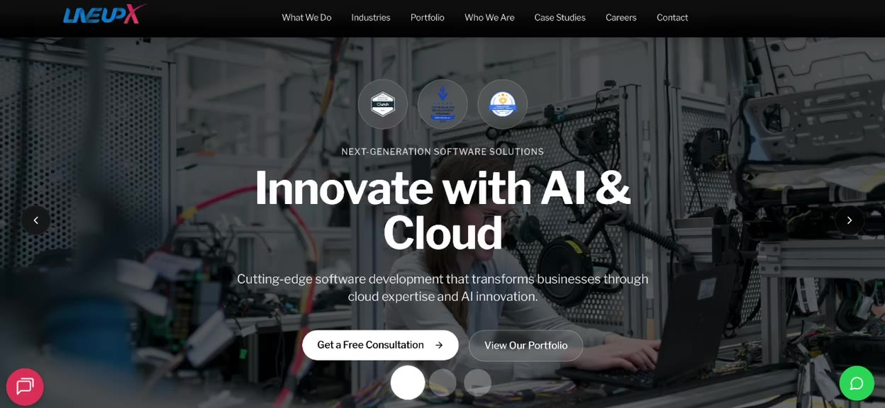</a>
<sub>▶️ Click to watch the demo</sub>

</td>
<td width="50%" valign="top">

### 🏗️ [BharatCore Projects](https://bcpinfra.in)
Construction, interior design & infrastructure across Delhi NCR.
**Trusted by Government of India · UPPCL tenders**

<a href="media/videos/bharatcore.mp4"></a>
<sub>▶️ Click to watch the demo</sub>

</td>
</tr>
<tr>
<td width="50%" valign="top">

### ⚡ SRMD Power Enterprises
UPPCL & NPCL contracts and tenders — power infrastructure execution.


</td>
<td width="50%" valign="top">

### ❤️ [Chaahat Foundation](https://chaahat.org)
*C. Impact Foundation* — NGO uplifting underprivileged children through education, meals & clothing.

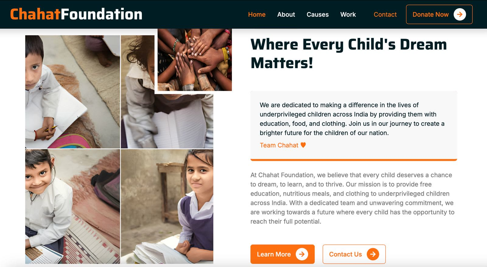

</td>
</tr>
</table>

---

## 🚀 Products & Platforms

### 🟢 Live

<table>
<tr>
<td width="50%" valign="top">

#### 🚀 [JustHunt.co](https://justhunt.co)
**#1 startup launchpad** — launch & discover new tech products. 1000+ startups launched and growing. Also the digital marketing, SEO, GEO, PPC & growth vertical of Liveupx.

<a href="media/videos/justhunt.mp4">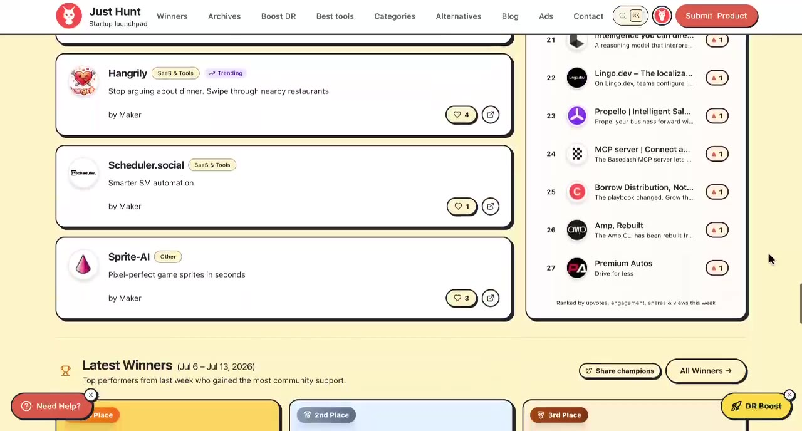</a>
<sub>▶️ Click to watch the demo</sub>

</td>
<td width="50%" valign="top">

#### 🌐 [tryHost.dev, formerly xHost](https://tryHost.dev)
AI-based cloud hosting for developers & agencies. Connect GitHub, pick a project, go live in seconds.
**🔥 23 acquisition offers received**

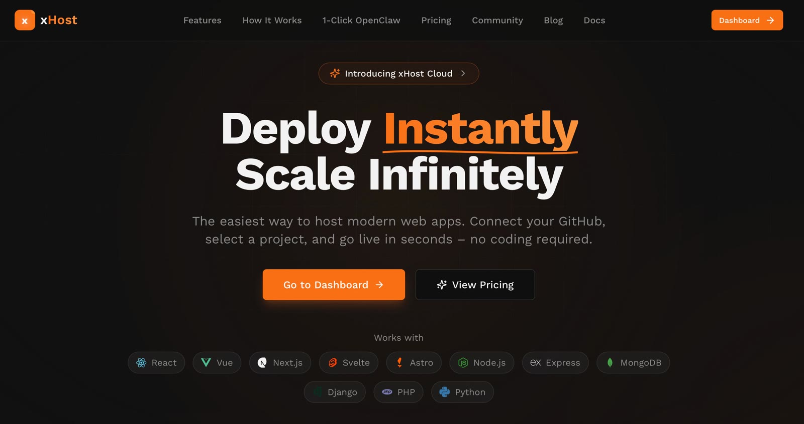

</td>
</tr>
<tr>
<td width="50%" valign="top">

#### 📊 [PitchDeck](https://pitch.liveupx.com)
Pitch-deck & presentation studio. Investor-ready storytelling for fundraising, partnerships and B2B communication.

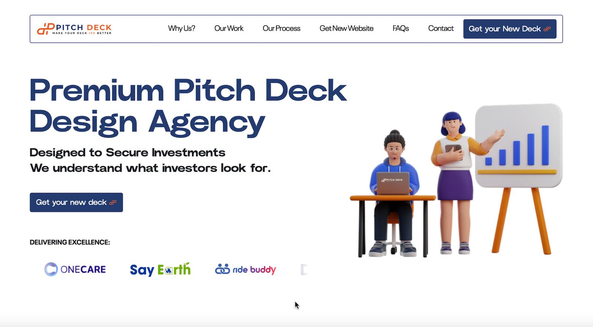

</td>
<td width="50%" valign="top">

#### 🎨 [KLIP Agency](https://klip.liveupx.com)
Social media management, branding, creative content & video editing — the brand voice, visual identity and content engine.

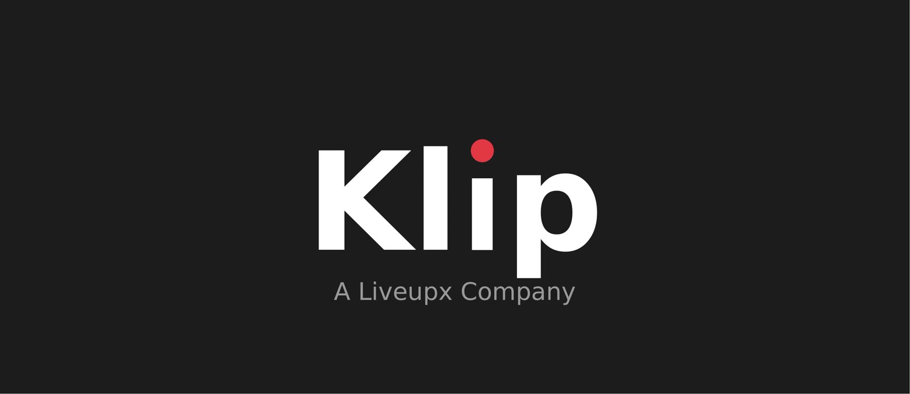

</td>
</tr>
<tr>
<td width="50%" valign="top">

#### 🏫 SmartEdmin.com
All-in-one school management system — 22 modules from admissions to transport. Flexible pricing by school size, no hidden module fees.

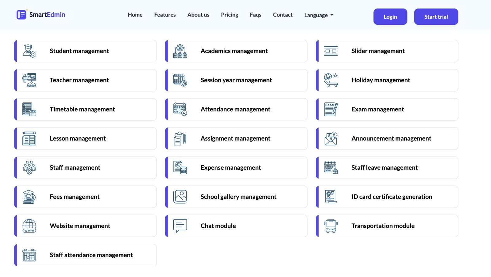

</td>
<td width="50%" valign="top">

#### 👨‍🏫 [MentorJi.live](https://mentorji.live)
EdTech for Foundation, JEE, NEET, CUET, UPSC & SSC — mock tests, PYQs, courses and live classes.

<a href="media/videos/mentorji.mp4">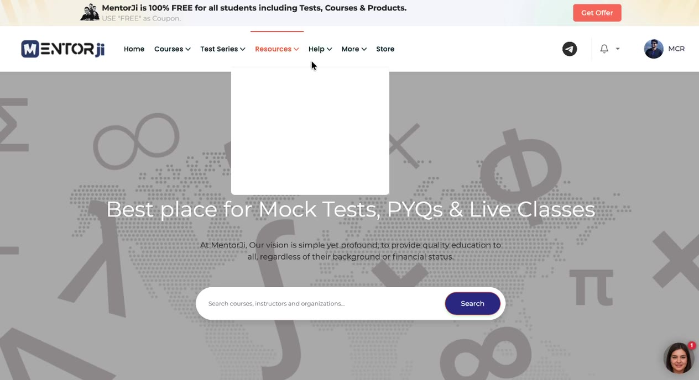</a>
<sub>▶️ Click to watch the demo</sub>

</td>
</tr>
<tr>
<td width="50%" valign="top">

#### 📱 Gurjar.app
Community platform with **215k users**.
*Acquisition talks ongoing — 40+ offers*

<a href="media/videos/gurjar.mp4"></a>
<sub>▶️ Click to watch the demo</sub>

</td>
<td width="50%" valign="top">
</td>
</tr>
</table>

### 🧪 Open Source

<table>
<tr>
<td width="50%" valign="top">

#### 🧬 [BioSentinel](https://github.com/liveupx/biosentinel)
AI-powered longitudinal health analysis. Predicts cancer & serious diseases *years before symptoms* using 3+ years of health data.
**MIT · 50+ disease models · FHIR R4 compatible**

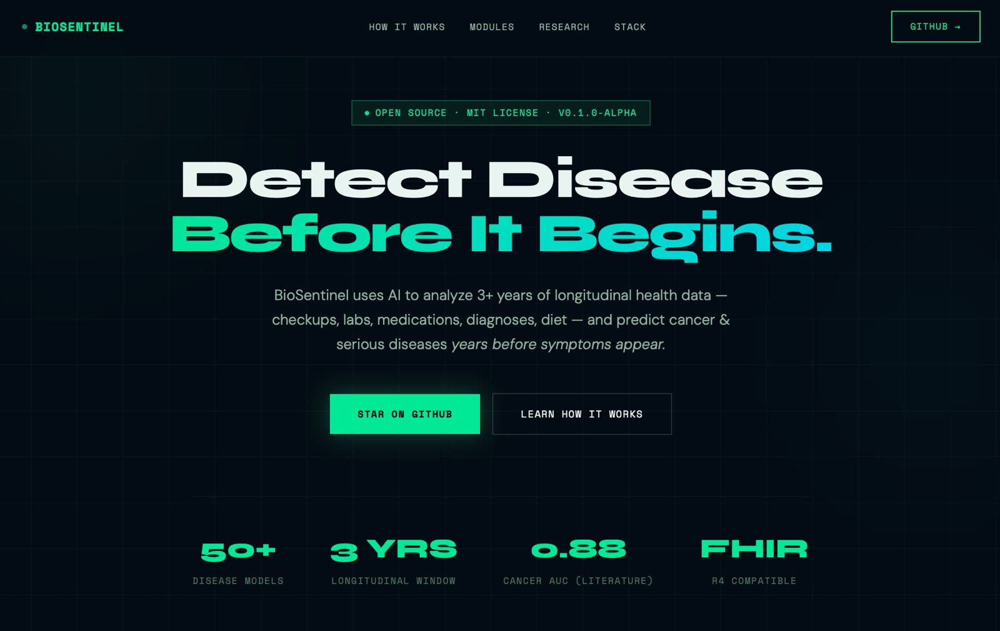

</td>
<td width="50%" valign="top">

#### 📧 [Apollo Scraper](https://apollo-email-scraper.xhost.live)
Chrome extension that exports Apollo.io contact data to CSV. No coding required.
**Free forever · 2,500 contacts per session**

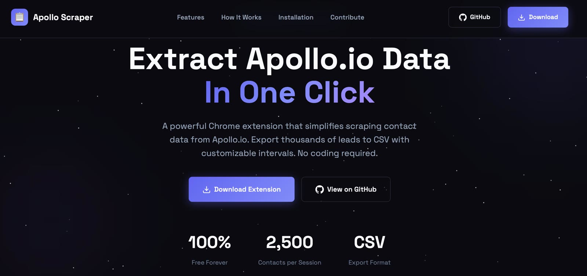

</td>
</tr>
</table>

### 🛠️ In Development

<table>
<tr>
<td width="50%" valign="top">

#### 🤖 EnjoHelp AI
*(formerly Widgetx AI)* — Train AI chatbots on your knowledge base. Automate support, capture leads, manage tickets in one platform.

<a href="media/videos/enjohelp-ai.mp4">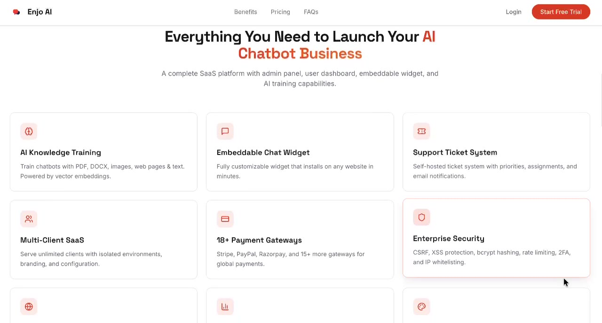</a>
<sub>▶️ Click to watch the demo</sub>

</td>
<td width="50%" valign="top">

#### 🧱 [Build88](https://build88.pp/)
AI vibe-coding platform by Liveupx — describe it, ship it.

<a href="media/videos/build8.mp4">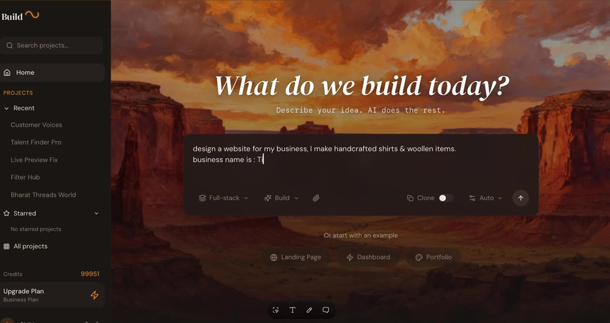</a>
<sub>▶️ Click to watch the demo</sub>

</td>
</tr>
<tr>
<td width="50%" valign="top">

#### 💬 BroDM.com
Instagram comment-to-DM automation + an AI agent that engages every lead instantly. Converts followers into customers 24/7.

<a href="media/videos/brodm.mp4">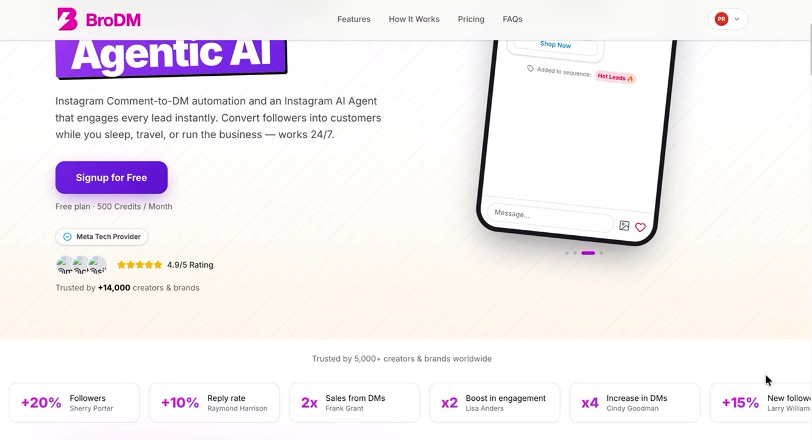</a>
<sub>▶️ Click to watch the demo</sub>

</td>
<td width="50%" valign="top">

#### 🧾 Reimburse.cc
Expense reimbursement SaaS — multi-level approvals, receipt capture, real-time budgets, tamper-proof audit trail. Multi-tenant and secure from day one.

<a href="media/videos/reimburse.mp4">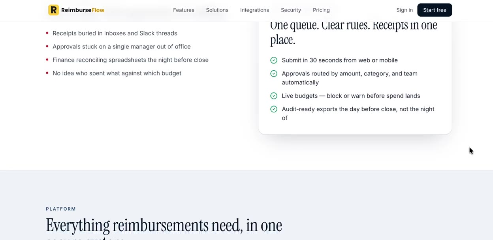</a>
<sub>▶️ Click to watch the demo</sub>

</td>
</tr>
<tr>
<td width="50%" valign="top">

#### 🌍 ConnectApp.cc
Social platform for Europe — Telegram-like chat, TikTok-like shorts, Zoom-like spaces, Udemy-like courses, XP for every action.

<a href="media/videos/connectapp.mp4">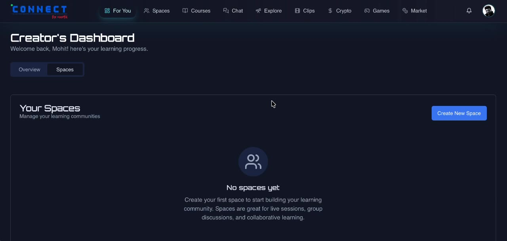</a>
<sub>▶️ Click to watch the demo</sub>

</td>
<td width="50%" valign="top">
</td>
</tr>
</table>

### 💰 Exited

<table>
<tr>
<td width="50%" valign="top">

#### 📝 LaLaForm — *sold*
The most affordable Typeform alternative. Unlimited forms & responses, logic, custom domains, file uploads.

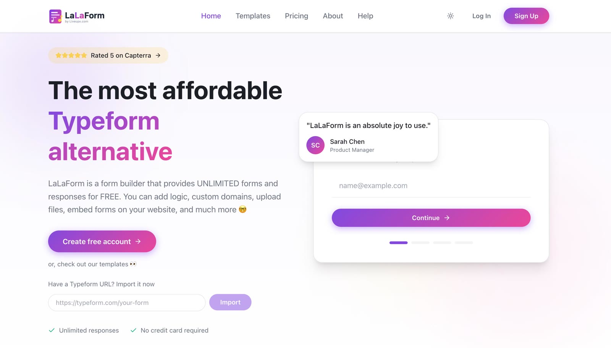

</td>
<td width="50%" valign="top">

#### 📞 PhonePicks — *sold*
Find your perfect phone in under 5 minutes. Smart phone decision engine.

</td>
</tr>
</table>

---

## 🧩 Chrome Extensions

| | Extension | What it does |
|---|---|---|
| 🔥 | **[ViralReply](https://chromewebstore.google.com/detail/viralreply-%E2%80%93-ai-reply-sug/felkgfmonmlbppdcanmciloabjilkcdk)** | AI-powered reply generator for LinkedIn & X — one click, viral-potential replies |
| 🔲 | **[QR Forge](https://chromewebstore.google.com/detail/qr-forge-%E2%80%94-qr-code-genera/hbncplbcmhiiabipgkkdkellkllbjiln)** | QR code generator |
| 🧮 | **[SuperCalc](https://chromewebstore.google.com/detail/supercalc-%E2%80%93-smart-calcula/gbpbheecbemddealgccbjaminpdfjifo)** | Smart calculator |
| 🖼️ | **[Convert HEIC to JPG](https://chromewebstore.google.com/detail/convert-heic-to-jpg/cmclimkfcjpgbedadipbfmpeakjfklmi)** | One-click HEIC → JPG converter |
| 🎥 | **[RecordPro](https://chromewebstore.google.com/detail/recordpro-screen-recorder/fhmebbenlfbbdaaakoeikofbpinpcfpb)** | Screen recorder |
| 🏷️ | **[X Account Labeler](https://chromewebstore.google.com/detail/x-account-labeler/olddccdenkempoaohcneepimbomcenao)** | Custom tags for X profiles |
| ⚡ | **[Website Speed Auditor](https://chromewebstore.google.com/detail/website-speed-auditor/ehipadngildclniokdbejkflfooeokac)** | One-click performance audit |

## 🔌 WordPress Plugins

| | Plugin | What it does |
|---|---|---|
| 🛡️ | **[Liveupx Security](https://wordpress.org/plugins/liveupx-security/)** | WordPress security hardening |
| 📈 | **[Liveupx SEO](https://wordpress.org/plugins/liveupx-seo)** | SEO optimization |

## 🤖 Telegram Bots

| | Bot | What it does |
|---|---|---|
| 📸 | **[Insta Bot](https://t.me/liveupx_insta_bot)** | Instagram content downloader |
| 📥 | **[Instagram Loader](https://t.me/instagram_load_bot)** | Instagram media downloader |
| 🎵 | **[Video to MP3](https://t.me/ivideo_to_mp3_full_converter_bot)** | Full video to MP3 converter |
| 🐦 | **[Twitter Vid Downloader](https://t.me/TwitterVidDownloaderBot)** | Download Twitter/X videos |

---

## 📊 GitHub Activity

<p align="center">
  
</p>

---

## 🔭 What I'm Doing

- **Building in public** — shipping across SaaS, AI, Chrome extensions, bots and cloud infra
- **Scaling Liveupx** — growing the dev studio and launching our own product suite
- **Angel investing** — backing early-stage founders building interesting things
- **Social impact** — running Chaahat.org to provide education & meals to underprivileged children
- **Open sourcing** — BioSentinel, Apollo Scraper, and more on the way

---

## 🤝 Connect

<p align="center">
  <a href="https://twitter.com/ammohitchaprana"></a>
  <a href="https://linkedin.com/in/ammohitchaprana"></a>
  <a href="https://instagram.com/ammohitchaprana"></a>
  <a href="https://www.youtube.com/c/@mohitchaprana"></a>
</p>
<p align="center">
  <a href="https://medium.com/@mohitchaprana"></a>
  <a href="https://github.com/ammohitchaprana"></a>
  <a href="https://dribbble.com/liveupx"></a>
  <a href="https://www.behance.net/ammohitchaprana"></a>
</p>

---

### 🏆 Recognition

- Founded **Liveupx at 18** — bootstrapped to 500+ projects, 40+ enterprise clients across 10+ countries
- **20+ ventures** built across software, AI, edtech, construction & non-profit
- **2 products sold** (LaLaForm, PhonePicks) — **Gurjar.app** in acquisition talks with 40+ offers
- **xHost.live** — 23 acquisition offers received
- **JustHunt.co** — 1000+ startups launched
- **7 Chrome extensions** on the Chrome Web Store
- **4 Telegram bots** and **2 WordPress plugins** on the official directory
- **First-gen entrepreneur** from a farming family in a small town in India

### 💭 Philosophy

> *"The people who are crazy enough to think they can change the world are the ones who do."* — Steve Jobs

> *"You learn something by doing it yourself, by asking questions, by thinking, and by experimenting."*

I don't wait for perfect. I build things that solve real problems, launch them, and iterate. I believe in questioning everything, doubting defaults, and shipping fast. Started from a small town with zero connections — today running companies across software, AI, infrastructure and social impact.

<details>
<summary><b>🎲 Random Facts</b></summary>

<br>

- Started coding at 15, founded first company at 18
- Mastered 8+ programming languages before graduating
- From a farming family — first-gen entrepreneur and investor
- Run 4 companies across completely different industries simultaneously
- Built and shipped 7 Chrome extensions, 4 Telegram bots, 2 WP plugins and multiple SaaS platforms
- Made first angel investment in 2024
- Believes in 5Ps: **P**erfect **P**ractice **P**revents **P**oor **P**erformance
- Coffee-powered, chaos-driven, permanently shipping

</details>

<p align="center"><sub>⭐ Star something of mine if it helped you build faster.</sub></p>
